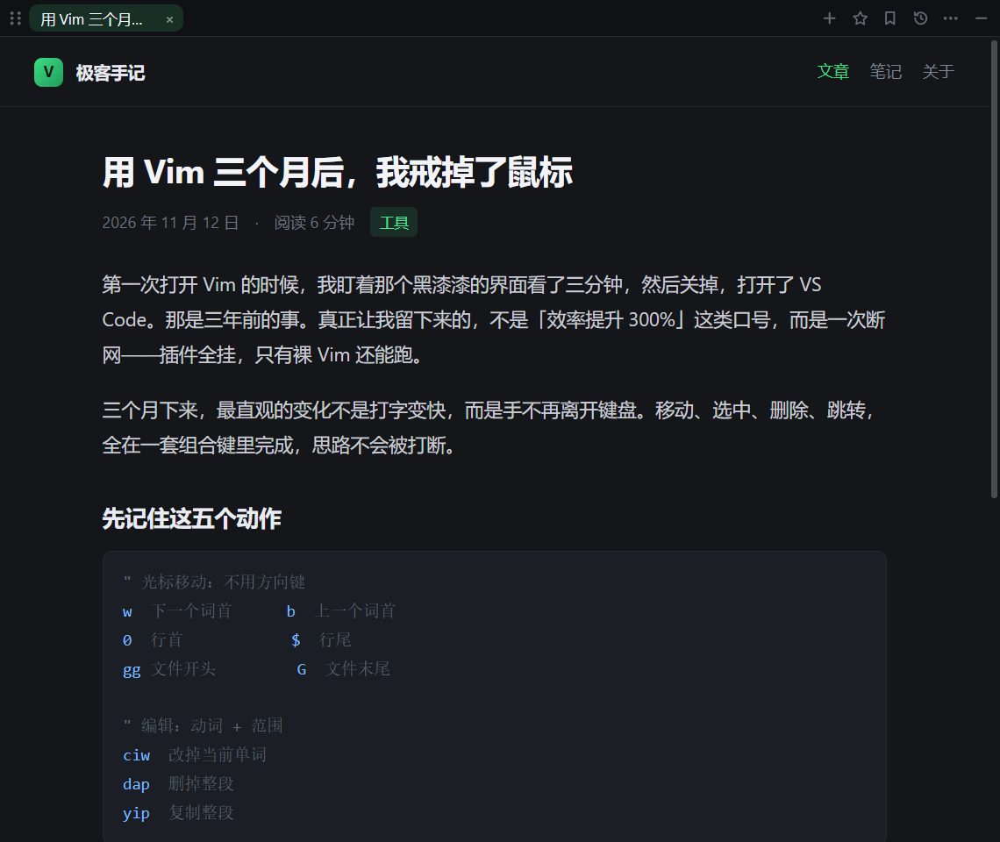

# 摸鱼鱼鱼

一个放在屏幕角落的**置顶摸鱼小窗**：无边框迷你浏览器 + 文档/漫画阅读器，`Alt+Q` 一键隐身。

[**⬇ 下载 Windows 安装包**](https://github.com/ni4fox/moyu-yuyu/releases/latest)　·　[MIT License](LICENSE)



## 功能

**窗口**
- 无边框、任意缩放、屏幕任意位置拖放（顶栏左上角点阵拖动）
- 置顶可开关；窗口透明度 30%~100% 可调；深色 / 灰 / 浅三套主题
- `Alt+Q` 全局热键显示 / 隐藏；关闭窗口即隐藏，托盘常驻
- 悬停显隐（可选开关）：鼠标离开约 1.5 秒自动隐藏，移回原位自动出现，不抢焦点

**浏览**
- 多标签页（最多 5 个），地址栏悬停顶栏时自动出现，离开 2 秒收起
- 后退 / 前进 / 刷新；页面超宽时底部出现横向滚动条
- 自适应排版（移动版布局）+ 适应宽度缩放，窄窗口看淘宝/资讯类站点不缺胳膊少腿
- OAuth 登录弹窗放行，网页里可以直接谷歌 / 微信登录
- 收藏夹、历史记录（各存 200 条，仅本地）
- 网页中键拖动页面、9px 细滚动条、`target=_blank` 链接自动开新标签页

**阅读**
- 文档：PDF、Word (.docx)、Markdown、纯文本 / 代码文件，拖进窗口即可打开
- 阅读模式：衬线字体排版、`A-` / `A+` 调字号、代码块 / 表格 / 引用样式
- 漫画 / 图片：单张图片、图片文件夹、CBZ / ZIP 图片包
  - 单页翻页：点左半屏上一页、右半屏下一页，`←` `→` `PgUp` `PgDn` `空格` 均可
  - 文件名自然排序（第 2 页排在第 10 页前面）、自动预载下一页
- `↗` 随时用系统默认程序打开原文件

**浏览器联动**
- 小窗在本机 `127.0.0.1` 起一个 HTTP 服务，带随机 token 鉴权
- 在浏览器里装一个书签脚本，看网页时点一下书签，当前页就被推进小窗

## 快捷键

| 快捷键 | 作用 |
| --- | --- |
| `Alt+Q` | 显示 / 隐藏小窗 |
| `Esc` | 关闭面板 / 阅读器 |
| `←` `→` `空格` `PgUp` `PgDn` | 漫画翻页 |
| `A-` / `A+` | 阅读字号 / 漫画缩放 |

## 安装

从 [Releases](../../releases/latest) 下载 `moyu-yuyu-setup-x.x.x.exe`，双击安装即可。

- 仅支持 Windows 10 / 11（x64）
- 不需要管理员权限，安装在当前用户目录
- 升级直接覆盖安装，设置和收藏都保留

## 数据与隐私

- 所有数据**只存本机**：窗口设置在 `layout.json`，收藏 / 历史在 localStorage，登录状态是 Chromium 加密存储的 Cookie
- 不上传、不同步任何数据
- 联动服务只监听 `127.0.0.1`，且每个请求必须带随机 token，本机其他程序或网页无法未授权推送内容
- 程序本身不保存任何账号密码

## 开发

```bash
npm install
npm start        # 开发运行
npm run dist     # 打包 NSIS 安装包（输出到 dist/）
```

测试模式（独立数据目录、不建托盘、不占全局热键）：

```bash
MOYU_TEST=1 MOYU_PORT=47899 npm start
```

## 项目结构

```
main.js               主进程：窗口 / 托盘 / 热键 / 设置持久化 / 联动服务
preload.js            渲染进程桥接 API
webview-preload.js    注入网页：中键拖动 / 滚动条 / 链接拦截 / 文件拖放
index.html            全部 UI 与阅读器
lib/comic.js          漫画解析：zip 中央目录 + store/deflate 解压 + 自然排序
lib/mammoth.browser.min.js   docx 转 HTML
```

技术栈：Electron 33、原生 JS（无框架）、electron-builder（NSIS 安装包）。

## 已知限制

- `.cbr` / `.rar`（RAR 压缩）暂不支持，解压成 CBZ 或直接拖图片文件夹
- 标签页上限 5 个，超出会自动关掉最旧的

## License

[MIT](LICENSE)
